Oi, sou o Matheus. Trabalho com suporte de TI e redes: câmera IP, equipamento de rede, configurar e testar
antes de ir pra campo. Comecei a programar porque tinha tarefa repetitiva demais no dia a dia e dava pra deixar
o computador fazer.

Hoje escrevo Python pra automatizar coisas do trabalho e estou estudando Java com Spring Boot e React. No tempo
livre mexo com Raspberry Pi.

### o que estou fazendo agora

Os relatórios das ordens de serviço eram baixados um por um no navegador. Fiz um app de Windows que entra no
sistema com um Chrome escondido e baixa tudo de uma vez: 2.000 OS viram 2.000 PDFs numa pasta, com histórico e
reprocessamento do que falhou.

Na 2.20 o PDF passou a ser gerado no próprio computador e um lote de 48 OS caiu de 32 s pra 15 s. Na 2.24 os
primeiros 50 PDFs já ficam prontos enquanto a pessoa ainda está revisando a busca. O código é privado porque é
de uso interno.

### com o que eu mexo

 

Fora do código: redes, videomonitoramento IP e configuração de dispositivo.

### contribuições

<picture>
  <source media="(prefers-color-scheme: dark)" srcset="https://raw.githubusercontent.com/MatheusEB/MatheusEB/refs/heads/output/github-snake-dark.svg">
  <source media="(prefers-color-scheme: light)" srcset="https://raw.githubusercontent.com/MatheusEB/MatheusEB/refs/heads/output/github-snake.svg">
  
</picture>

Pra falar comigo: [LinkedIn](https://www.linkedin.com/in/matheus-eduardo-basto-7288a6368).

